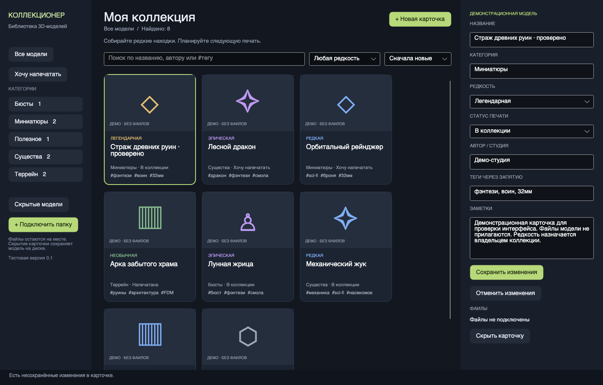

# Коллекционер

**Коллекционер** — настольное приложение для систематизации библиотеки моделей для 3D-печати. Оно помогает хранить карточки моделей, раскладывать их по коллекциям и категориям, отмечать редкость и статус печати, а также просматривать STL/OBJ прямо в приложении.

> Это развиваемый прототип. В комплекте нет файлов моделей для печати: демонстрационные карточки нужны только для знакомства с интерфейсом.



## Возможности

- Коллекции и категории, карточки моделей, поиск и сортировка.
- Редкость от обычной до легендарной и статусы «В коллекции», «Хочу напечатать», «Напечатана».
- Добавление папки или файлов модели в библиотеку: приложение может скопировать материалы в управляемое хранилище или оставить файлы на исходном месте.
- 3D-просмотр STL и OBJ с вращением на подиуме. Просмотр ограничивает очень большие входные файлы и число полигонов, чтобы не перегружать компьютер.
- Пять оформлений интерфейса: «Мастерская», «Атлас», «Шоурум», «Полки» и «Чертёж».
- Фоновая музыка и короткие звуки интерфейса. Сведения о происхождении аудио и CC0-лицензии находятся в [`PROVENANCE.md`](src/Collector.Desktop/Assets/Audio/PROVENANCE.md).
- Дизайн экранов и тем вынесен в Avalonia XAML (`.axaml`), поведение — в C#.

## Запуск на macOS или Windows

Нужен [.NET 10 SDK](https://dotnet.microsoft.com/download/dotnet/10.0). Откройте папку проекта в VS Code или терминале.

```sh
dotnet restore Collector.slnx
dotnet run --project src/Collector.Desktop/Collector.Desktop.csproj
```

На macOS можно также открыть `Запустить Коллекционер.command`. При первом запуске .NET загрузит зависимости проекта.

Данные приложения создаются отдельно от исходников в системной папке пользователя. Для временного или тестового каталога можно указать свой путь:

```sh
dotnet run --project src/Collector.Desktop/Collector.Desktop.csproj -- --data-dir ./my-collector-data
```

## Проект в VS Code

Откройте `Collector.slnx`. Быстрые задачи сборки, запуска приложения и проверок доступны через меню **Terminal → Run Task** (`⌘⇧P` / `Ctrl+Shift+P`, затем `Tasks: Run Task`). Интерфейсные файлы находятся в `src/Collector.Desktop`: `MainWindow.axaml`, `Views/` и `Themes/`.

## Структура

| Папка | Назначение |
|---|---|
| `src/Collector.Core` | Каталог, поиск, чтение папок, хранение, импорт, разбор и отрисовка 3D-сеток |
| `src/Collector.Desktop` | Приложение Avalonia, окна, карточки, темы, звук и предпросмотр модели |
| `tests` | Проверки каталога, интерфейса, звука, 3D-просмотра и хранения |
| `tools` | Утилиты проекта, в том числе создание резервных копий и генерация аудио |

```text
Avalonia UI / .axaml
        │
        ▼
Collector.Desktop ───────► Collector.Core
                                  ├── каталог и поиск
                                  ├── импорт и управление файлами
                                  └── чтение и отрисовка 3D-сеток
```

## Запуск проверок

```sh
dotnet run --project tests/Collector.Checks/Collector.Checks.csproj
dotnet run --project tests/Collector.UiChecks/Collector.UiChecks.csproj
dotnet run --project tests/Collector.AudioChecks/Collector.AudioChecks.csproj
dotnet run --project tests/Collector.PreviewChecks/Collector.PreviewChecks.csproj
dotnet run --project tests/Collector.StorageChecks/Collector.StorageChecks.csproj
```

## Безопасность файлов

Локальные данные каталога, модели, резервные копии, архивы и результаты сборки исключены из Git. При добавлении модели исходные файлы сохраняются на месте; режим управляемого хранения создаёт отдельную копию. Подробности текущих ограничений и планов будут дополняться вместе с развитием прототипа.

## Лицензии

Для кода приложения общая лицензия в этом репозитории пока не назначена. Это не меняет лицензии внешних библиотек. Локальные звуковые материалы имеют отдельные условия CC0-1.0, описанные рядом с файлами.
